# 📊 UIII Act3: Importación y Descripción de Datos
## Iker Montoya 0105 
# empleado de indsutria 
> **🎓 Asignatura:** Soluciona problemas de Machine Learning  
> **📚 Nivel:** Tercer semestre de preparatoria  
> **🤖 Especialidad:** Inteligencia Artificial  
> **📈 Dificultad:** Cero a principiante  
> **🐍 Lenguaje:** Python  
> **🛠️ Herramientas:** Visual Studio Code, Pandas, Matplotlib y CSV 
## tabla de empleados 
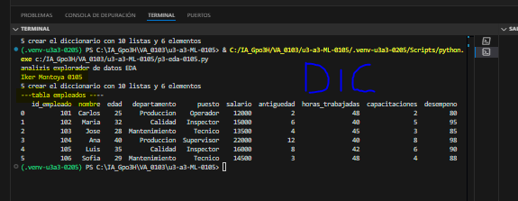
## convertir el datframe en archivo no 
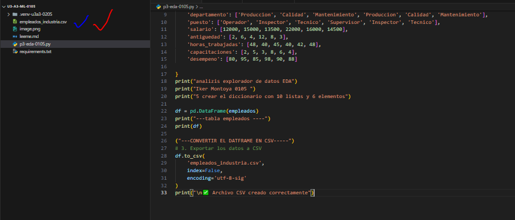
## DATOS DE CVS 
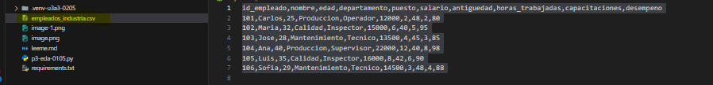
# leer los datos csv 
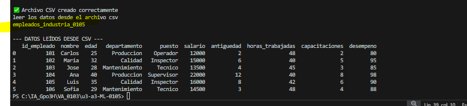

print("\n2. ÚLTIMOS REGISTROS (Tail):")
print(df.tail(2)) # Muestra los últimos 2

# 5. primerop y ultimos registros 
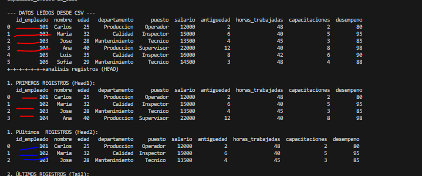

# 6. Dimensiones y estructura
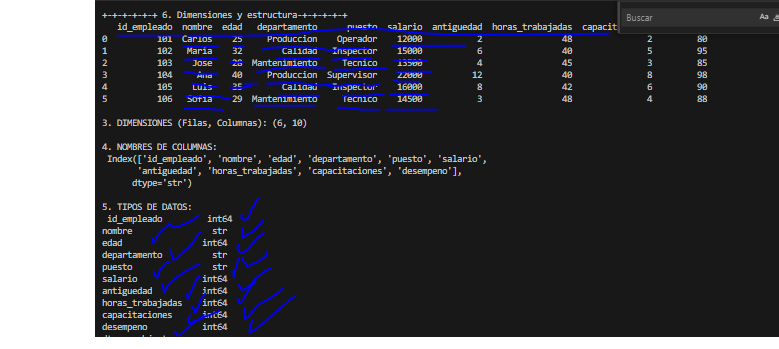

#  7. Estadísticas y limpieza
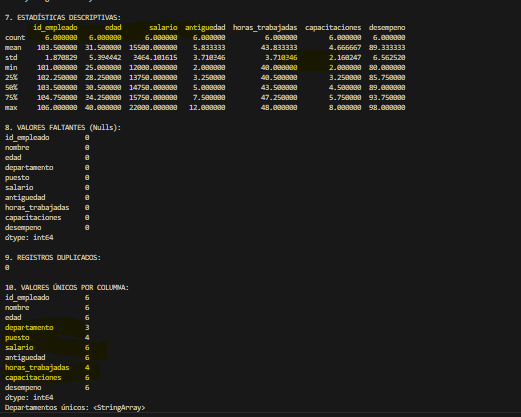

## 8 y 9 puntos 
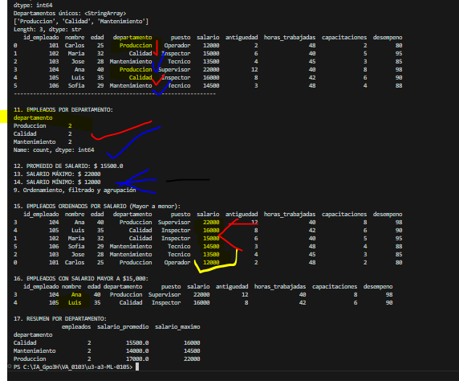

# 18. Gráfica de barras: Empleados por departamento
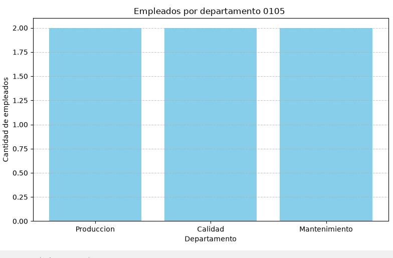

# 19. Gráfica de barras: Salarios por empleado
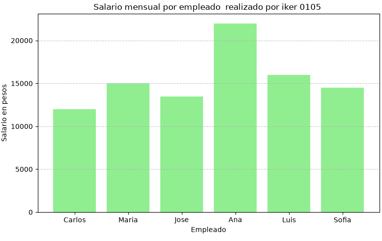

# 20. Histograma: Distribución de edades
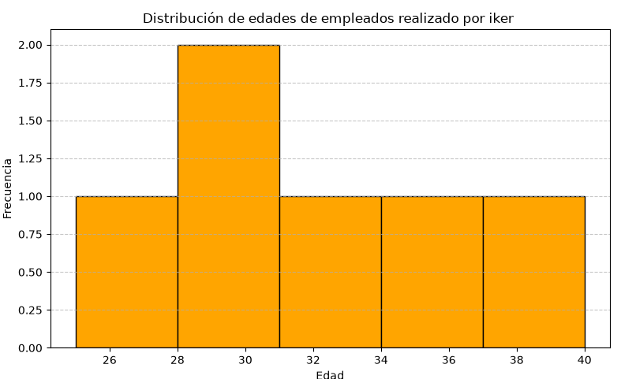

# 21. Gráfica de dispersión: Edad vs Salario
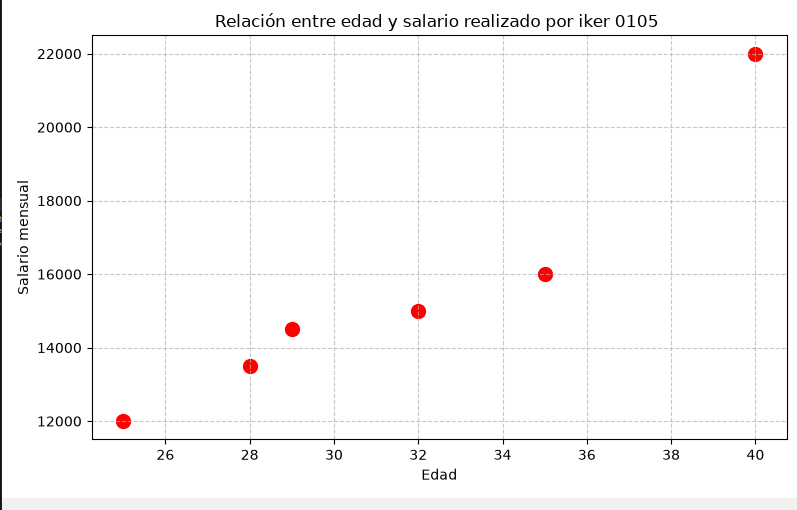

 ## 22. Diagrama de caja: Distribución de salarios
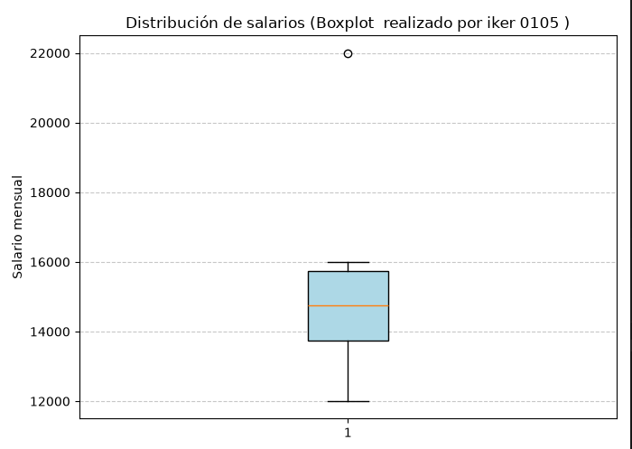
 # 23. Matriz de correlación
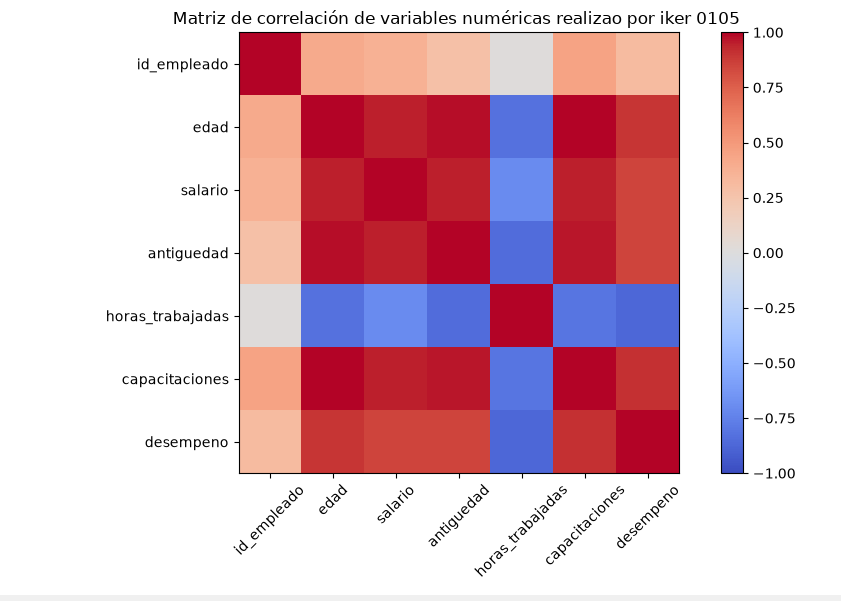